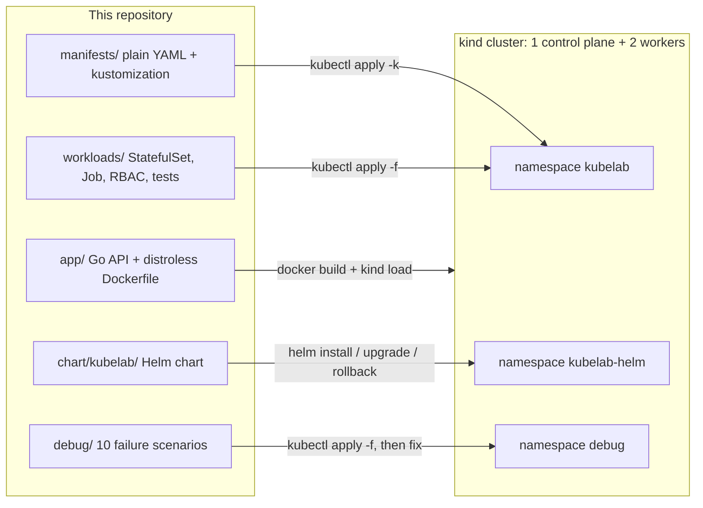

# k8s-helm-lab

**Learn Kubernetes and Helm by doing: deploy one app with plain YAML, then with Helm 4, break it ten ways, and run the cluster underneath.**

[](https://github.com/georgesmomo/k8s-helm-lab/actions/workflows/ci.yml)
[](LICENSE)
[](https://georgesmomo.github.io/k8s-helm-lab/)


### ▶ [Start the interactive course](https://georgesmomo.github.io/k8s-helm-lab/)

19 stations, 104 concept sheets, a rolling-update simulator, a debug triage drill, quizzes and a final exam, all built on real outputs captured from this lab. Free, no account, progress saved in your browser.

---

## Why this repository exists

I'm **Georges MOMO**, a DevSecOps engineer. I built this lab to learn Kubernetes properly, in public, the way it is actually used at work: not by copying a Helm command from a README, but by writing every object by hand, understanding why it exists, then letting Helm generate it, and finally breaking it and fixing it.

I wanted something I could not find in one place: a path that goes from "what is a pod" to "drain a node, back up etcd and plan a kubeadm upgrade", with enterprise best practices at every step and certification preparation on top. Everything here runs on a laptop, and every terminal output in the course comes from a real cluster running this exact repository. I'm sharing it so that anyone can use it to reach a senior level with real practice instead of slides.

## What you will learn

- **The model**: desired state, controllers and the reconciliation loop, the idea behind everything else.
- **The machine**: API server, etcd, scheduler, controller manager, kubelet, kube-proxy, container runtime, CNI, CoreDNS, CSI, and the path of a request through authentication, RBAC and admission.
- **Every object family**: Pods and probes, Deployments and rolling updates, StatefulSets, DaemonSets, Jobs and CronJobs, ConfigMaps and Secrets, Services, EndpointSlices, DNS, Ingress and the Gateway API, NetworkPolicies, PV/PVC/StorageClass, requests, limits and QoS, affinity, taints, topology spread, HPA, PDB, quotas, RBAC, ServiceAccounts, Pod Security Admission, CRDs and operators.
- **Lab 1, plain YAML**: deploy an API with eleven production-grade manifests and `kubectl apply -k`, update it and roll it back.
- **Lab 2, Helm 4**: the same app as a chart with helpers, a values schema, a config checksum, a migration hook and a test; install, upgrade, roll back, push to an OCI registry. Helm 4 specifics included (server-side apply, kstatus waiting, `--rollback-on-failure`).
- **Debugging**: ten failure scenarios taken from real incidents (ImagePullBackOff, CrashLoopBackOff, OOMKilled, Pending, readiness, empty Service, missing ConfigMap, PVC Pending, RBAC, liveness), plus `kubectl debug` on distroless images.
- **Administration**: cordon/drain/uncordon with PDBs, etcd snapshots, certificate expiry, the kubeadm upgrade sequence, kubelet and node health.
- **Enterprise practice**: the review checklist, the classic anti-patterns, and CKA / CKAD / CKS preparation.

## Who it is for

- Developers and ops engineers who use Kubernetes but want to understand it end to end.
- People preparing the **CKA**, **CKAD** or **CKS**.
- Anyone moving towards a DevSecOps or platform engineering role.

You should be comfortable with a terminal, basic Linux and Docker. No prior Kubernetes knowledge is required: the course starts from zero and goes deep.

**Tools** (versions used for the course outputs):

| Tool | Version | Notes |
|---|---|---|
| Docker (or Podman) | recent | 6 GB of memory for Docker is comfortable |
| [kind](https://kind.sigs.k8s.io/) | 0.33 or newer | runs a real kubeadm cluster in containers |
| kubectl | 1.36 or newer | the cluster runs Kubernetes 1.37 |
| [Helm](https://helm.sh/docs/intro/install/) | 4.x (4.2 used) | Helm 3 differs on several flags |

## How to use this repository to learn

1. **Follow the course.** Open the [interactive course](https://georgesmomo.github.io/k8s-helm-lab/) and go station by station. Each one explains the concept with an analogy, the precise version, how companies use it and where it hurts, then gives you something to do and a short quiz.
2. **Run the lab next to it.** Every command in the course works against this repository on your own kind cluster. Your names and IPs will differ; the behaviour will not.
3. **Train for the exams.** Replay the failure scenarios until each one takes you less than three minutes, use the concept sheets' exam tips, and finish with the final exam and the challenge list.

## Learning path

| # | Station | Time | You practise |
|---|---|---|---|
| 0 | Welcome aboard | 30 min | Create the kind cluster, load the images, install metrics-server |
| 1 | Desired state | 30 min | Reconciliation, with an interactive "kill a pod" widget |
| 2 | Architecture | 1 h 30 | Static pods, `crictl`, API server flags |
| 3 | kubectl and the API | 1 h | Contexts, `explain`, `jsonpath`, `--dry-run`, Kustomize |
| 4 | Workloads | 2 h | Probes, rolling update simulator, Jobs and CronJobs |
| 5 | Configuration | 45 min | ConfigMaps, Secrets, Downward API |
| 6 | Networking | 2 h | Services, DNS, Gateway API, NetworkPolicy, port-forward |
| 7 | Storage | 1 h | PVC, StorageClass, StatefulSet with per-pod DNS |
| 8 | Resources and placement | 2 h | QoS calculator, HPA under load, PDB, quotas |
| 9 | Security | 2 h | RBAC with `auth can-i`, Pod Security, encryption at rest |
| 10 | CRDs and operators | 45 min | Gateway API CRDs, owner references |
| 11 | **Lab 1: kubectl apply** | 2 h | Apply, roll out, smoke test, NetworkPolicy proof, update and undo |
| 12 | Helm concepts | 1 h 30 | Charts, values, releases, hooks, tests, Helm 4 |
| 13 | **Lab 2: Helm** | 2 h | Lint, template, install, test, upgrade, rollback, OCI, write a template |
| 14 | **Debug like a senior** | 3 h | Ten real failures, triage drill, `kubectl debug` |
| 15 | Run the cluster | 3 h | Drain with PDBs, etcd backup, certificates, kubeadm upgrade |
| 16 | Enterprise review | 45 min | The production checklist and anti-patterns |
| 17 | CKA, CKAD, CKS | 30 min | Domains mapped to the course, exam strategy |
| 18 | Final exam | 45 min | 25 questions and 13 challenges |

Count three to four weeks at about an hour a day for a solid CKA level.

## How the lab fits together



## Quick start

```bash
git clone https://github.com/georgesmomo/k8s-helm-lab && cd k8s-helm-lab

# A real 3-node cluster in Docker (1 control plane + 2 workers)
kind create cluster --name lab --config kind/cluster.yaml

# Build the app and load it into every node (no registry needed)
docker build -t kubelab:1.0.0 --build-arg VERSION=1.0.0 app
docker build -t kubelab:1.1.0 --build-arg VERSION=1.1.0 app
kind load docker-image kubelab:1.0.0 kubelab:1.1.0 --name lab

# Part 1: plain YAML
kubectl apply -k manifests/
kubectl -n kubelab rollout status deploy/kubelab
kubectl -n kubelab get deploy,rs,svc,endpointslices,pdb,hpa,networkpolicy,resourcequota
kubectl apply -f workloads/job-cronjob.yaml
kubectl -n kubelab logs job/smoke-test

# Part 2: the same app with Helm 4
helm lint chart/kubelab
helm install demo chart/kubelab -n kubelab-helm --create-namespace --wait
helm test demo -n kubelab-helm --logs
helm upgrade demo chart/kubelab -n kubelab-helm --set message="Version 2" --wait
helm history demo -n kubelab-helm
helm rollback demo 1 -n kubelab-helm

# Part 3: break things on purpose
kubectl apply -f debug/00-namespace.yaml -f debug/02-crashloopbackoff.yaml
kubectl -n debug get pods -w

# Clean up
kind delete cluster --name lab
```

For `kubectl top` and the HPA, install metrics-server (kind does not ship it):

```bash
kubectl apply -f https://github.com/kubernetes-sigs/metrics-server/releases/latest/download/components.yaml
kubectl -n kube-system patch deployment metrics-server --type=json \
  -p '[{"op":"add","path":"/spec/template/spec/containers/0/args/-","value":"--kubelet-insecure-tls"}]'
```

## Repository structure

| Path | What it contains |
|---|---|
| `app/` | `kubelab`, a small Go API (standard library only): `/`, `/healthz`, `/readyz`, `/version`, `/metrics`, `/stress/cpu`, `/stress/memory`, plus `migrate` and `check` subcommands used by Jobs and Helm hooks. Multi-stage Dockerfile to a distroless, non-root image. |
| `manifests/` | Namespace with Pod Security `restricted`, ConfigMap, Secret (teaching example), ServiceAccount, Deployment (3 probes, resources, securityContext, topology spread, Downward API), Service, PDB, HPA, NetworkPolicies, ResourceQuota + LimitRange, HTTPRoute, `kustomization.yaml`. |
| `workloads/` | StatefulSet with a headless Service, Job + CronJob, developer RBAC, NetworkPolicy test pods, a Pod Security test pod that must be rejected. |
| `chart/kubelab/` | Helm chart: `_helpers.tpl`, config checksum, pre-install/pre-upgrade migration hook, `helm test` pod, `values.schema.json`, `values-prod.yaml` (HPA, external Secret, NetworkPolicy, HTTPRoute). |
| `debug/` | Ten failure scenarios and the RBAC fix. See [debug/README.md](debug/README.md). |
| `kind/` | `cluster.yaml` for your machine; `sandbox-cluster.yaml`, the variant used to capture the course outputs in an offline sandbox. |
| `docs/` | The interactive course, published with GitHub Pages. |
| `.github/workflows/` | `ci.yml` replays the whole lab on kind; `pages.yml` publishes the course. |

## The failure scenarios

| # | Scenario | Symptom you will see | Skill you build |
|---|---|---|---|
| 01 | Image tag that does not exist | `ImagePullBackOff` | Reading pod events |
| 02 | Missing environment variable | `CrashLoopBackOff`, exit code 2 | `kubectl logs --previous` |
| 03 | Memory limit too low | `OOMKilled`, exit code 137 | Last State, sizing limits |
| 04 | Requests of 64 CPUs | `Pending`, `FailedScheduling` | How the scheduler filters nodes |
| 05 | Wrong readiness path | `Running` but `0/1` | Probe design |
| 06 | Service selector typo | Empty EndpointSlice | Labels and selectors |
| 07 | ConfigMap not found | `CreateContainerConfigError` | Configuration references |
| 08 | Unknown StorageClass | PVC and pod `Pending` | Dynamic provisioning |
| 09 | ServiceAccount without a Role | `Forbidden` (403) | RBAC and `kubectl auth can-i` |
| 10 | Liveness probe on a slow starter | Restart loop although the app is healthy | startup vs readiness vs liveness |

## Continuous integration

Every push and pull request runs [`ci.yml`](.github/workflows/ci.yml) on GitHub Actions:

- **App tests + chart lint**: `go vet` and `go test`, `helm lint` with the default and the production values, then `helm template` and the raw manifests validated with kubeconform.
- **Cluster kind + kubectl + Helm + debug**: builds the image, creates a three-node kind cluster, then replays the course: part 1 (`kubectl apply`, rollout, smoke test), part 1b (NetworkPolicy allowed/denied pods, Pod Security rejection), part 2 (Helm install, test, upgrade, history, rollback) and part 3 (applies the failure scenarios and checks each failure really shows up, then applies the RBAC fix).

Third-party actions are pinned to full commit SHAs and the workflow token is read-only. A second workflow, [`pages.yml`](.github/workflows/pages.yml), publishes `docs/` to GitHub Pages.

## Certification mapping

| Exam | Domains | Where to practise here |
|---|---|---|
| **CKA** | Troubleshooting 30%, cluster architecture/installation/configuration 25%, services and networking 20%, workloads and scheduling 15%, storage 10% | Debug, Run the cluster, Architecture, Networking, Storage, `debug/` |
| **CKAD** | Application design and build 20%, deployment 20%, observability and maintenance 15%, environment/configuration/security 25%, services and networking 20% | Workloads, Configuration, Lab 1, Lab 2, `chart/` |
| **CKS** | Cluster setup 15%, cluster hardening 15%, system hardening 10%, microservice vulnerabilities 20%, supply chain 20%, monitoring/logging/runtime security 20% | Security, `workloads/psa-test.yaml`, `workloads/rbac-developer.yaml`, and the supply-chain courses of the series |

Check the [official curricula](https://training.linuxfoundation.org/certification/certified-kubernetes-administrator-cka/) before you register: weights and versions evolve.

## Troubleshooting

| Problem | Likely cause and fix |
|---|---|
| Nodes stay `NotReady` | Docker is short of memory. Give it 6 GB or more, then delete and recreate the cluster. |
| `kind create cluster` fails with "port is already allocated" | Something on your machine uses port 8080 (mapped in `kind/cluster.yaml`). Free it or change `hostPort`. |
| Pods in `ImagePullBackOff` for `kubelab:1.0.0` | The image was not loaded into the nodes: run `kind load docker-image kubelab:1.0.0 --name lab` again. |
| HPA shows `<unknown>` forever, `kubectl top` fails | metrics-server is not installed: see the Quick start. |
| `probe-denied` succeeds instead of failing | Your CNI does not enforce NetworkPolicies (older kind versions). Upgrade kind and recreate the cluster. |
| `kubectl apply -f workloads/psa-test.yaml` fails | That is the point: Pod Security rejects this pod. |
| `helm install` says the name is in use | A previous release exists: `helm uninstall demo -n kubelab-helm`, or use `helm upgrade --install`. |
| `unknown flag: --rollback-on-failure` | You are on Helm 3 (where it is `--atomic`). Install Helm 4. |

## The DevSecOps Learning Series

This lab is one of three free, hands-on courses that build on each other:

| Course | Repository | Interactive course |
|---|---|---|
| **GitHub Actions DevSecOps**: secure CI/CD from the first workflow to signed images deployed on Kubernetes, GH-200 prep | [georgesmomo/devsecops-actions-lab](https://github.com/georgesmomo/devsecops-actions-lab) | [Open the course](https://georgesmomo.github.io/devsecops-actions-lab/) |
| **GitLab CI/CD DevSecOps**: the same supply chain with GitLab | [georges.momo.n8n/devsecops-gitlab-lab](https://gitlab.com/georges.momo.n8n/devsecops-gitlab-lab) | [Open the course](__GITLAB_PAGES_URL__) |
| **Kubernetes + Helm** (this one): run what those pipelines build | [georgesmomo/k8s-helm-lab](https://github.com/georgesmomo/k8s-helm-lab) | [Open the course](https://georgesmomo.github.io/k8s-helm-lab/) |

## Contributing

Found a mistake, an outdated fact or a better way to explain something? [Open an issue](https://github.com/georgesmomo/k8s-helm-lab/issues) or a pull request. The CI replays the whole lab on kind, so changes to manifests, the chart or the scenarios are tested automatically.

## License

[MIT](LICENSE). Use it, fork it, teach with it.

## Author

**Georges MOMO**, DevSecOps engineer.
GitHub: [@georgesmomo](https://github.com/georgesmomo) · GitLab: [@georges.momo.n8n](https://gitlab.com/georges.momo.n8n)

If this lab helped you, a star on the repository helps others find it.
